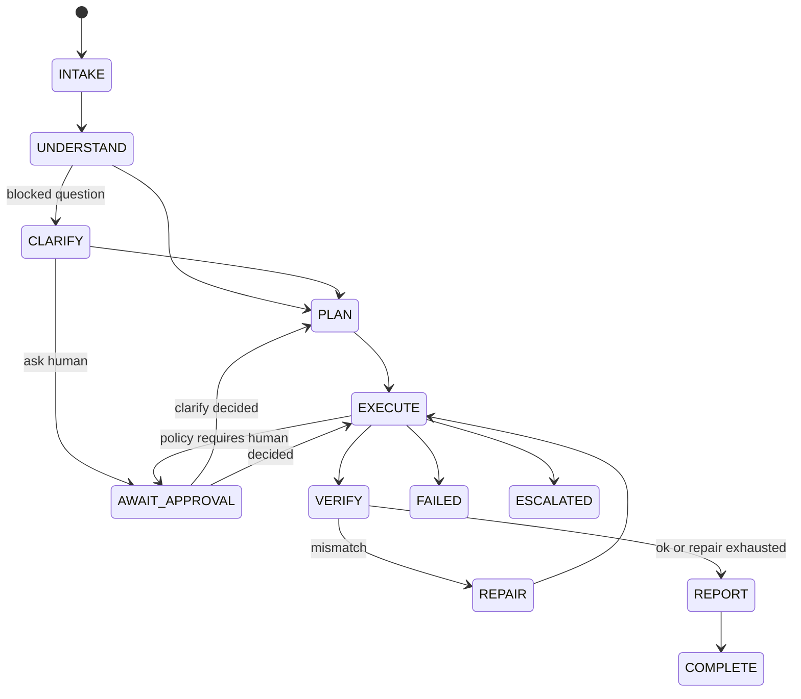
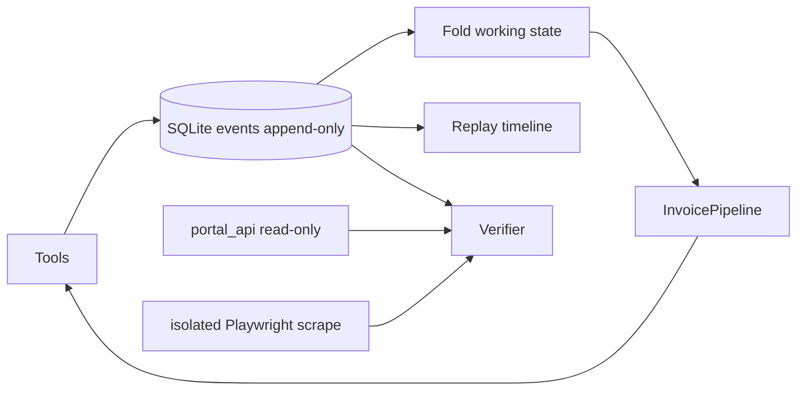
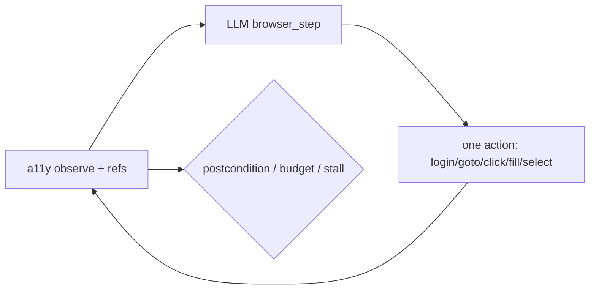

# Architecture

## One-sentence design
An event-sourced Operator turns a company request into completed portal work, proves outcomes with an independent verifier, and interrupts humans only for policy/ambiguity.

## Runtime loop

**Single control plane:** `InvoicePipeline` owns all phases via `StateMachine` / FSM. `Orchestrator.start()` only allocates `run_id`.

**Plans vs procedure:** The top-level LLM plan is structural/logging (`PLAN_CREATED`); EXECUTE does **not** walk those steps. The invoice procedure in `InvoicePipeline._execute` loads PDFs, runs `PolicyEngine.decide_invoice`, then builds a per-invoice sub-plan that **mirrors** the decision already taken. `_act_on_invoice` dispatches on sub-plan step tools (browser submit / ask_human) — enum-shaped dispatch, not a general plan executor.

## Event sourcing

## Trust boundaries
- PDF/web text wrapped as `<<<UNTRUSTED_DATA>>>` — never instructions
- Passwords via secrets provider; portal stores PBKDF2 hashes; redacted from logs/events
- Verifier uses a **fresh** Playwright context + portal_api session (agent never grades itself)
- Submit-class browser scrape is a **hard** criterion (miss fails the run)
- Irreversible submits require policy clearance + idempotency keys
- `/admin/faults` requires auth

## Browser execute→observe→adapt (SPEC §6.5–6.7)

### Measured vs optional path

| Path | Trigger | Writes |
|------|---------|--------|
| **a11y loop (default)** | `make eval` / `make eval-llm`, `use_browser_loop=True` | One action at a time (`scripted_browser_step` under FakeLLM; model under Haiku). RPA repair after miss is **off**. |
| RPA shortcut (optional) | `make eval-rpa` / `--no-browser-loop` | High-level `submit_invoice` (still real Playwright) |

Clearance + `IrreversibleLedger` + independent verifier wrap **both** paths. Policy/verify never go through FakeLLM. FakeLLM **does** drive portal writes on the a11y path via `scripted_browser_step`.

## Package map
- `ark_operator/runtime` — pipeline (phases), browser_loop, recovery, budgets, stall, plan_revision
- `ark_operator/tools` — browser, pdf_extract (LLM+confidence), files, knowledge, portal_api, ask_human
- `ark_operator/policy` — rules.yaml + decision engine
- `ark_operator/verify` — independent checks + evidence
- `ark_operator/memory` — knowledge FTS + event-conditioned episodic lessons
- `company_world` — deterministic AcmeCorp Procure world
