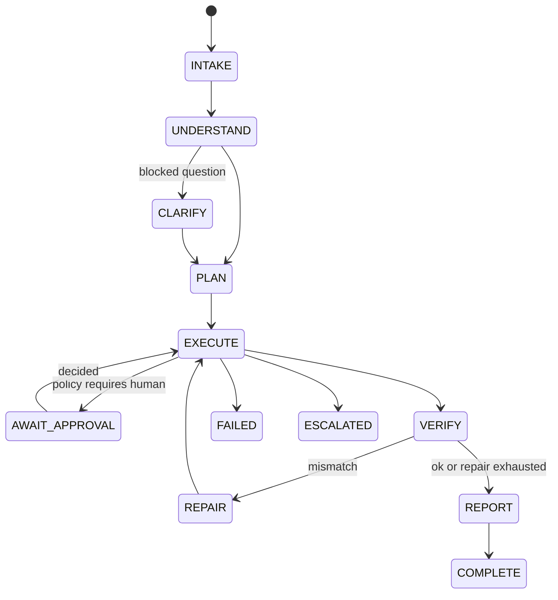
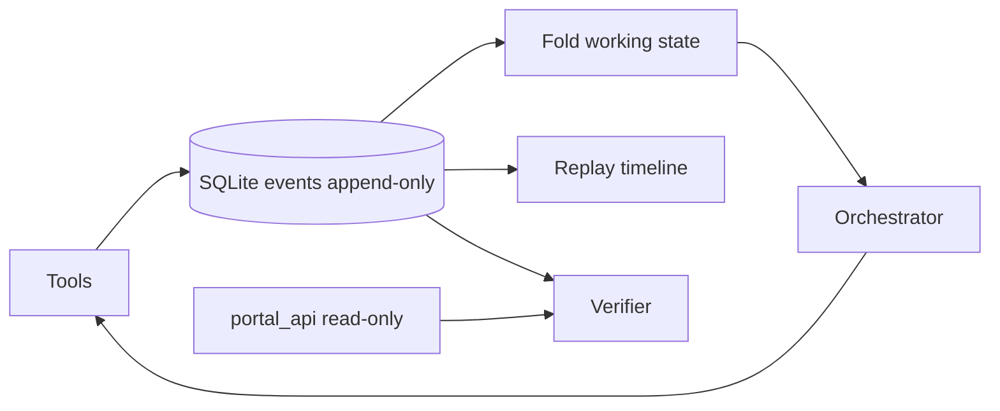
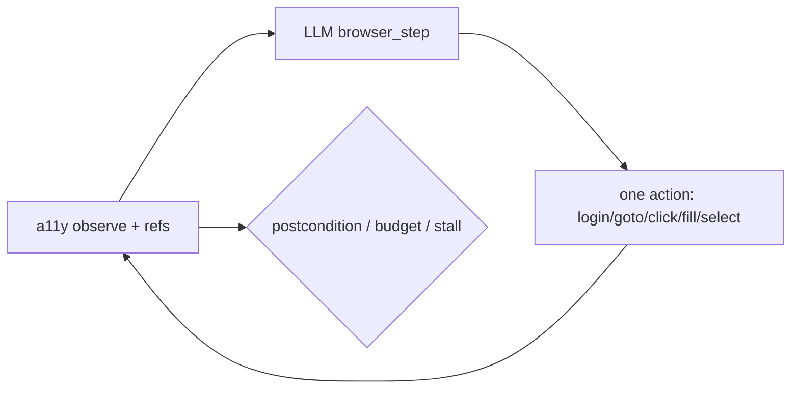

# Architecture

## One-sentence design
An event-sourced Operator turns a company request into completed portal work, proves outcomes with an independent verifier, and interrupts humans only for policy/ambiguity.

## Runtime loop

## Event sourcing

## Trust boundaries
- PDF/web text wrapped as `<<<UNTRUSTED_DATA>>>` — never instructions
- Passwords via secrets provider; redacted from logs/events
- Verifier uses a **fresh** portal_api session (agent never grades itself)
- Irreversible submits require policy clearance + idempotency keys

## Browser execute→observe→adapt (SPEC §6.5–6.7)

Dual path: **Anthropic / `use_browser_loop=True`** uses the loop above; **FakeLLM CI** keeps high-level `submit_invoice` (real Playwright) for eval speed. Clearance + `IrreversibleLedger` wrap both paths.

## Package map
- `ark_operator/runtime` — orchestrator, pipeline, browser_loop, executor, recovery, budgets
- `ark_operator/tools` — browser, pdf, files, knowledge, portal_api, ask_human
- `ark_operator/policy` — rules.yaml + decision engine
- `ark_operator/verify` — independent checks + evidence
- `company_world` — deterministic AcmeCorp Procure world
